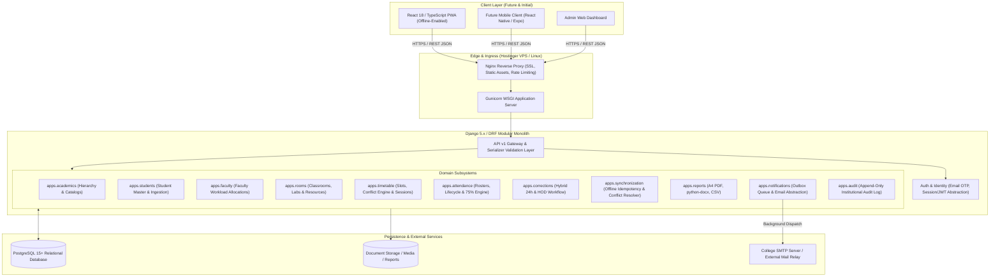

# System Architecture Specification

**Document ID:** ARCH-SYS-001  
**Project:** College Attendance Management System  
**Date:** October 2026  
**Pattern:** API-First Modular Monolith (Server-Authoritative)  

---

## 1. High-Level Architecture Topology

The Attendance Management System is architected as an **API-first modular monolith**. All business rules, statutory attendance calculations, role authorizations, and audit records reside strictly within the server.

---

## 2. Invariant: Server Authority

Clients (whether future React PWA or React Native mobile apps) are untrusted runtimes. The server enforces:
1. **Academic Truth:** Official percentages, threshold alerts, and attendance totals are computed exclusively on the backend.
2. **Timetable Rules:** Sessions, cancellations, and reschedulings are verified against master schedule rules.
3. **Audit Immutability:** Audit records are generated automatically on write operations and cannot be modified by client payloads.
4. **Idempotency:** Offline synchronization batches are validated against existing database state; re-transmissions cannot double-count marks.

---

## 3. Modular Monolith Subsystem Breakdown

| Subsystem Module | Directory | Core Responsibilities |
| :--- | :--- | :--- |
| `accounts` | `backend/apps/accounts/` | Custom User model, Email OTP generation/verification, rate limiting, RBAC permissions, token lifecycle. |
| `academics` | `backend/apps/academics/` | Department, Program, AcademicYear, Semester, Division, Subject models and relations. |
| `students` | `backend/apps/students/` | Student profiles, privacy display formatting (last-4 PRN), enrollment records, CSV/Excel import parser. |
| `faculty` | `backend/apps/faculty/` | Faculty profile, department affiliation, subject/division workload assignments. |
| `rooms` | `backend/apps/rooms/` | Classroom and Laboratory catalogs, capacity, resource tagging, and conflict detection queries. |
| `timetable` | `backend/apps/timetable/` | Recurring timetable slots, concrete dated sessions (theory & lab), scheduling conflict engine, cancellations, rescheduling lineage. |
| `attendance` | `backend/apps/attendance/` | Roster attendance marking, session state lifecycle (Draft -> Reviewed -> Finalized), conservative auto-finalization, 75% calculation engine. |
| `corrections` | `backend/apps/corrections/` | Hybrid attendance correction requests (faculty <=24h self-correction, older HOD review/approval), approval history. |
| `synchronization`| `backend/apps/synchronization/`| Offline sync contract, idempotency token verification, conflict detection, atomic batch commit. |
| `notifications` | `backend/apps/notifications/`| Outbox queue, delivery status tracking, 75% deficiency state machine, anti-spam cooldown, email provider abstraction. |
| `reports` | `backend/apps/reports/` | Official A4 PDF rendering (ReportLab/WeasyPrint), editable Microsoft Word (`python-docx`), and CSV exports. |
| `audit` | `backend/apps/audit/` | Immutable append-only audit trail capturing actor, action, timestamp, object reference, old/new state, and reason. |
| `common` | `backend/apps/common/` | Shared utilities, base models (`TimeStampedModel`), standard pagination, unified error envelope. |
