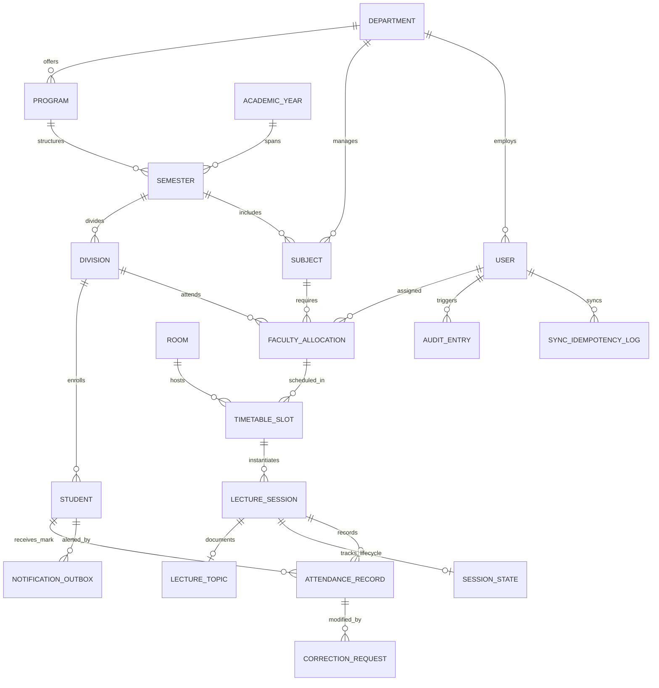

# Entity-Relationship Diagram (ERD)

**Document ID:** DOC-DB-ERD-001  
**Project:** College Attendance Management System  
**Date:** October 2026  

---

## 1. Domain Entity Relationship Diagram

---

## 2. Referential Integrity & Deletion Rules

| Parent Entity | Child Entity | Foreign Key Policy | Rationale |
| :--- | :--- | :--- | :--- |
| `Department` | `Subject` | `models.PROTECT` | Deleting a department with active/historical subjects is blocked. |
| `Subject` | `LectureSession` | `models.PROTECT` | Historical conducted sessions must never lose subject reference. |
| `Student` | `AttendanceRecord` | `models.PROTECT` | Departing students cannot cause cascading loss of attendance logs. |
| `LectureSession` | `AttendanceRecord` | `models.PROTECT` | Lecture attendance records cannot be deleted via session deletion. |
| `LectureSession` | `LectureTopic` | `models.CASCADE` | Topic log is a 1-to-1 extension of the session itself. |
| `LectureSession` | `SessionState` | `models.CASCADE` | Session lifecycle state is a 1-to-1 extension of the session. |
| `User` | `AuditEntry` | `models.SET_NULL` | If a user account is removed, audit logs remain with `actor=NULL` preserving history. |
